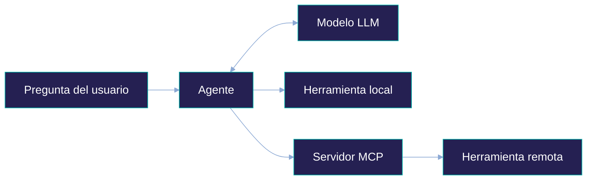
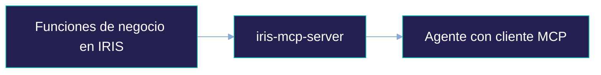
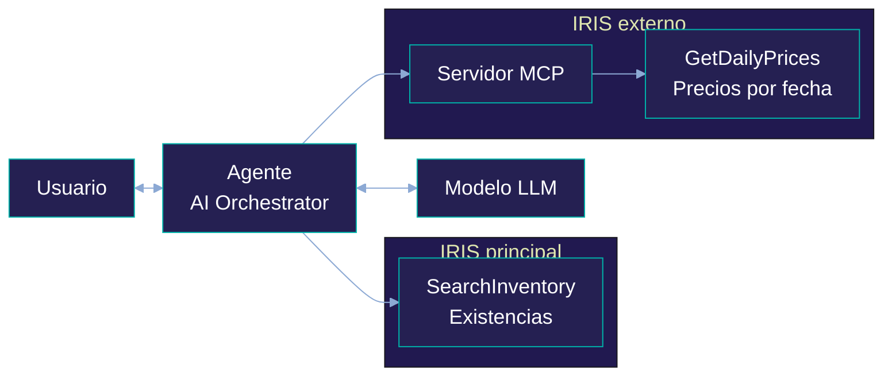

# Agentes de IA con IRIS
## Modelos de lenguaje, agentes y herramientas con InterSystems AI Hub

<!--
Duración orientativa: 20–25 minutos, según la respuesta del modelo.
Orden de la charla: 1) cuatro conceptos, 2) las capacidades de InterSystems IRIS, 3) una consulta en AI Orchestrator.
Explicar primero los conceptos y la plataforma de forma independiente. Introducir el caso de inventario y precios sólo en el bloque final.
Preparar el entorno antes de la sesión según demo/README.md. La charla no incluye un taller de configuración.
-->

---
name: agente
---

# ¿Qué es un agente?

<p class="concept-definition">Una aplicación que utiliza un modelo de lenguaje para resolver una tarea y puede recurrir a herramientas.</p>

Un agente reúne **un objetivo**, **instrucciones** y **las capacidades que tiene autorizadas**.

## Cómo trabaja

Interpreta la petición, propone los pasos y solicita la ejecución de las herramientas permitidas.

Utiliza los resultados para continuar la tarea o preparar una respuesta para el usuario.

<p class="takeaway">El agente coordina la tarea dentro de los límites que hemos definido.</p>

<!--
Empezar por el propósito, sin entrar en clases, proveedores o pantallas de administración.
Un agente puede usar una o varias herramientas y realizar varios pasos. También puede responder sin herramientas cuando la tarea lo permita.
El modelo propone el siguiente paso y el programa del agente gestiona las llamadas autorizadas.
No atribuir voluntad ni garantizar que el modelo elija siempre correctamente. El comportamiento se evalúa con ejemplos reales.
-->

---
name: herramienta
---

# ¿Qué es una herramienta?

<p class="concept-definition">Una función que el agente puede invocar para consultar datos o realizar una operación concreta.</p>

| Elemento | Qué define | Para qué sirve |
|---|---|---|
| Nombre y descripción | La función que ofrece | Ayudar al modelo a elegirla |
| Parámetros | Los datos de entrada y sus tipos | Construir la llamada |
| Resultado | Los datos o el estado de la operación | Continuar la tarea |

<p class="takeaway">Las herramientas conectan la conversación con las funciones de negocio.</p>

<!--
Una herramienta es código que ya sabe hacer una tarea, por ejemplo consultar una tabla o llamar a una API.
El agente proporciona argumentos, el sistema ejecuta la función y devuelve el resultado al agente.
Las herramientas pueden consultar o modificar datos. Su contrato debe describir de forma precisa los argumentos y el resultado.
-->

---
name: modelo-llm
---

# ¿Qué es un modelo LLM?

<p class="concept-definition">Un modelo de lenguaje entrenado para procesar texto y generar respuestas a partir del contexto que recibe.</p>

En un agente, un modelo compatible con llamadas a herramientas puede:

- Interpretar la pregunta y las instrucciones.
- Proponer qué herramienta utilizar y con qué parámetros.
- Redactar la respuesta a partir de los resultados recibidos.

<p class="takeaway">El modelo aporta las capacidades de lenguaje. Las herramientas aportan los datos de negocio.</p>

<!--
LLM significa Large Language Model, modelo de lenguaje de gran tamaño.
Un mismo modelo puede utilizarse en agentes con objetivos y herramientas diferentes.
El modelo puede ejecutarse localmente o en un servicio externo, según la configuración y los requisitos del entorno.
Puede equivocarse. Una respuesta convincente no prueba que los datos sean correctos: es necesario comprobar su origen.
-->

---
name: servidor-mcp
---

# ¿Qué es un servidor MCP?

<p class="concept-definition">Un servicio que publica capacidades de un sistema mediante el protocolo MCP, Model Context Protocol.</p>

En la publicación de **herramientas**, el protocolo permite:

1. El cliente consulta qué herramientas ofrece el servidor.
2. Conoce sus parámetros y puede solicitar su ejecución.
3. El servidor ejecuta la función y devuelve el resultado.

El cliente utiliza un contrato común para acceder a funciones de sistemas diferentes.

<!--
MCP es un protocolo compartido entre cliente y servidor. El agente utiliza un cliente MCP para comunicarse con el servicio.
MCP contempla otras capacidades, pero aquí sólo necesitamos explicar el catálogo de herramientas y su invocación.
Un servidor MCP puede estar junto a los datos o delante de una API. Su publicación sigue necesitando permisos y controles.
Fuente de la implementación IRIS: https://docs.intersystems.com/components/csp/docbook/DocBook.UI.Page.cls?KEY=BAIHUB_mcp
-->

---
name: conceptos-juntos
---

# Cómo se relacionan los cuatro conceptos



El agente se apoya en el modelo y utiliza herramientas locales o publicadas mediante MCP.

<p class="takeaway">Una pregunta puede necesitar herramientas de distintos sistemas.</p>

<!--
Recorrer el esquema señalando cada término ya explicado, en lugar de introducir nuevos conceptos.
El modelo ayuda a decidir las llamadas. El programa del agente las ejecuta bajo los controles definidos.
El esquema es conceptual: las herramientas pueden pertenecer a sistemas de negocio diferentes.
La flecha entre agente y modelo resume el intercambio de contexto, propuestas de llamadas y resultados.
-->

---
name: ai-hub
---

# InterSystems AI Hub

<p class="concept-definition">Las capacidades de IRIS para desarrollar aplicaciones con modelos de lenguaje, agentes y herramientas.</p>

Dos vías para integrar estas capacidades:

- **SDK ObjectScript:** construir agentes que utilicen modelos y funciones de negocio.
- **Servidor MCP:** publicar herramientas de IRIS para clientes compatibles.

<p class="takeaway">AI Hub proporciona la base para implementar estos conceptos cerca de los datos y la lógica de IRIS.</p>

<!--
Aquí empieza el segundo bloque. Presentar AI Hub después de que la audiencia comprenda los términos.
El SDK ObjectScript permite crear agentes y herramientas y configurar policies. El catálogo y la interfaz de AI Orchestrator pertenecen al proyecto.
La documentación consultada describe AI Hub con un Early Access Program. Confirmar versión, disponibilidad y soporte antes de una implantación.
Fuentes: https://docs.intersystems.com/components/csp/docbook/DocBook.UI.Page.cls?KEY=BAIHUB_overview
https://docs.intersystems.com/components/csp/docbook/DocBook.UI.Page.cls?KEY=BAIHUB_sdk
-->

---
name: ai-hub-agentes
---

# AI Hub: construcción de agentes

El SDK reúne los componentes que necesita una aplicación para conversar con un modelo y ejecutar herramientas.

| Componente | Responsabilidad |
|---|---|
| Proveedor y modelo | Conexión al servicio LLM y selección del modelo |
| Agente y sesión | Instrucciones, contexto de conversación y ejecución |
| Herramientas | Métodos ObjectScript con un contrato de entrada y salida |

<p class="takeaway">La aplicación define la tarea y las capacidades disponibles para resolverla.</p>

<!--
El proveedor encapsula la conexión y su configuración. El agente selecciona un modelo y un SystemPrompt.
Una sesión mantiene el contexto del intercambio y permite continuar la conversación.
Las clases principales son %AI.Provider, %AI.Agent, %AI.Agent.Session y %AI.ToolSet. Nombrarlas sólo si aporta valor a la audiencia.
Los proveedores documentados incluyen OpenAI, Anthropic, Gemini y otros. La compatibilidad y las opciones dependen del proveedor y de la versión instalada.
Fuente: https://docs.intersystems.com/components/csp/docbook/DocBook.UI.Page.cls?KEY=BAIHUB_sdk
-->

---
name: ai-hub-herramientas
---

# AI Hub: conexión con la lógica de negocio

Las herramientas convierten funciones de la aplicación en operaciones que puede utilizar un agente.

1. Definir el método ObjectScript y su contrato.
2. Describir la función, sus parámetros y sus resultados.
3. Incorporar las herramientas al agente mediante su gestor de herramientas.

El método puede consultar datos de IRIS o acceder a servicios conectados.

<p class="takeaway">La lógica de negocio permanece en funciones explícitas y reutilizables.</p>

<!--
%AI.ToolSet agrupa definiciones de herramientas. %AI.ToolMgr gestiona las herramientas disponibles para el agente.
El método implementa la operación y decide cómo acceder a SQL, objetos o servicios externos. No significa que el modelo reciba acceso irrestricto a la base de datos.
Hay que validar los argumentos y conservar los controles del sistema de negocio.
Fuente: https://docs.intersystems.com/components/csp/docbook/DocBook.UI.Page.cls?KEY=BAIHUB_sdk
-->

---
name: xml-tools
---

# Publicación de herramientas con XML

El XML se declara en **XData Definition** de una clase que extiende **%AI.ToolSet**.

```xml
<ToolSet Name="ConsultasNegocio">
  <Description>Consultas de datos operativos</Description>
  <Include Class="App.Demo.InventoryTools"
           Tool="SearchInventory"/>
  <Include Class="App.Demo.ShipmentTools"
           Tool="SearchShipmentsByDateRange"/>
</ToolSet>
```

**Include** reutiliza una clase. **Tool** selecciona el método que estará disponible.

El agente incorpora la clase con `agent.UseToolSet("Ejemplo.ConsultasNegocio")`.

<!--
Ejemplo declarativo del SDK, basado en dos herramientas existentes del proyecto. Todavía no abrir la consola ni presentar el caso de la demostración.
El fragmento pertenece a XData Definition [ MimeType = application/xml ] dentro de una clase Ejemplo.ConsultasNegocio Extends %AI.ToolSet.
Compilar la clase permite procesar su definición. Luego el agente incorpora la clase mediante UseToolSet; se debe comprobar el %Status que devuelve.
El nombre de clase ObjectScript Ejemplo.ConsultasNegocio identifica lo que se carga con UseToolSet. Name="ConsultasNegocio" identifica el conjunto en el XML.
Los nombres SearchInventory y SearchShipmentsByDateRange corresponden a métodos existentes. No mostramos su implementación porque el objetivo es entender la selección declarativa.
Los tipos y las descripciones de los métodos aportan el contrato de parámetros. Include sin Tool incluiría todas las herramientas publicadas por la clase; con Tool se hace una selección exacta.
Esto incorpora herramientas al agente. Para publicarlas por MCP se necesita además configurar el endpoint y el transporte, explicados en la diapositiva del servidor MCP.
Fuente: https://docs.intersystems.com/components/csp/docbook/DocBook.UI.Page.cls?KEY=BAIHUB_sdk, secciones Toolsets y Tool Composition and Filtering.
-->

---
name: ai-hub-control
---

# AI Hub: control del uso de herramientas

Las **policies** permiten incorporar reglas al uso de las herramientas.

| Capacidad | Qué permite definir |
|---|---|
| Autorización | Qué herramientas se pueden listar y ejecutar |
| Auditoría | Qué información registrar de cada ejecución |
| Descubrimiento | Cómo construir herramientas disponibles en tiempo de ejecución |

<p class="takeaway">Los controles se implementan en el sistema que ejecuta las herramientas.</p>

<!--
El SDK proporciona clases base para implementar las policies. La aplicación aporta las reglas y el destino del registro.
La autorización puede evaluar quién llama y las condiciones de la operación. La auditoría recibe llamada, resultado, duración y estado.
El descubrimiento dinámico del SDK es una capacidad distinta de consultar el catálogo de un servidor MCP.
No confundir estas capacidades con un catálogo administrativo o una consola listos para usar: esas pantallas pertenecen a la aplicación construida sobre el SDK.
Fuente: https://docs.intersystems.com/components/csp/docbook/DocBook.UI.Page.cls?KEY=BAIHUB_sdk
-->

---
name: xml-policies
---

# Policies asociadas al ToolSet

El bloque **Policies** referencia las clases que aplican los controles al conjunto.

```xml
<ToolSet Name="ConsultasNegocio">
  <Include Class="App.Demo.InventoryTools" Tool="SearchInventory"/>
  <Include Class="App.Demo.ShipmentTools" Tool="SearchShipmentsByDateRange"/>
  <Policies>
    <Authorization Class="App.AIHub.Policy.UserAccess"/>
    <Audit Class="App.AIHub.Policy.DatabaseAudit"/>
  </Policies>
</ToolSet>
```

**Authorization** comprueba el acceso. **Audit** registra las ejecuciones.

<p class="demo-small">Este ejemplo muestra la asociación XML del SDK. En AI Orchestrator configuramos las policies en el agente.</p>

<!--
Continuación del mismo ToolSet de la diapositiva de publicación XML. El contenido se declara en XData Definition de una clase que extiende %AI.ToolSet.
Las clases referenciadas ya existen en el proyecto: UserAccess extiende %AI.Policy.Authorization y DatabaseAudit extiende %AI.Policy.Audit.
El XML asocia las clases; las comprobaciones y el registro se implementan en sus métodos ObjectScript. No basta con escribir el nombre de una clase que no implemente el contrato.
UserAccess usa el usuario y el agente presentes en App.AIHub.RuntimeContext; DatabaseAudit usa ese contexto para atribuir la ejecución y el RequestId. Estas clases requieren ejecutar dentro del contexto inicializado por la aplicación.
El SDK también admite policies en el gestor del agente. AI Orchestrator utiliza ese mecanismo y compone la auditoría con DynamicAudit, sin configurar auditoría en las tools.
No proponer activar simultáneamente el mismo destino de auditoría en ambos niveles: el SDK ejecuta ambos y podría duplicar registros. La diapositiva ilustra una alternativa declarativa; no modifica las herramientas ni las policies del despliegue.
Fuente: https://docs.intersystems.com/components/csp/docbook/DocBook.UI.Page.cls?KEY=BAIHUB_sdk, secciones Policies y Policy Composition.
-->

---
name: mcp-iris
---

# El servidor MCP incluido en IRIS

En las versiones con AI Hub, **iris-mcp-server** publica las herramientas de IRIS para clientes MCP compatibles.



Las funciones existentes pueden convertirse en capacidades que utilicen otros agentes o aplicaciones.

<p class="takeaway">IRIS puede crear agentes y también ofrecer herramientas a agentes de otros entornos.</p>

<!--
El SDK define las herramientas y el endpoint de IRIS. El binario iris-mcp-server proporciona el transporte que consume el cliente MCP.
La publicación permite reutilizar funciones de IRIS desde aplicaciones que actúan como clientes MCP, aunque dichas aplicaciones no estén construidas sobre IRIS.
No es necesario explicar Docker, puertos o autenticación durante la introducción. Esos detalles quedan en la preparación.
Fuente: https://docs.intersystems.com/components/csp/docbook/DocBook.UI.Page.cls?KEY=BAIHUB_mcp
-->

---
name: mcp-publicacion
---

# Ejemplo: publicar herramientas por MCP

**External.Demo.InventoryTools** extiende `%AI.Tool` e implementa `SearchInventory` y `GetDailyPrices(name, day)`.

```text
Class External.MCP.Tools Extends External.Demo.InventoryTools
{
}

Class External.MCP.Service Extends %AI.MCP.Service
{
Parameter SPECIFICATION As STRING = "External.MCP.Tools";
}
```

Registramos **/mcp/demo** en IRIS con esa clase de servicio y lo configuramos en **iris-mcp-server**.

<p class="takeaway">El cliente descubre las herramientas con tools/list y las ejecuta con tools/call.</p>

<!--
Ejemplo basado en las clases reales del servidor iris-mcp, sin adelantar el recorrido de la demostración.
External.Demo.InventoryTools extiende %AI.Tool. External.MCP.Tools hereda sus métodos; en el proyecto añade también propiedades descriptivas, omitidas aquí para centrarse en la publicación.
Las clases del bloque se guardan y compilan por separado en el namespace MCP. El SDK obtiene los contratos a partir de los métodos, sus tipos, comentarios y descripciones de parámetros.
Este ejemplo utiliza la herencia de %AI.Tool, no el ToolSet XML mostrado anteriormente: no hay un XML adicional con la lista de métodos en esta implementación.
SPECIFICATION enlaza el servicio con la clase que ofrece las herramientas. iris-mcp/iris.script registra /mcp/demo con Type=18, NameSpace=MCP, DispatchClass=External.MCP.Service y autenticación habilitada.
iris-mcp/config.toml conecta iris-mcp-server con iris-mcp:1972 y declara endpoints=[{path="/mcp/demo", ...}] con credenciales obtenidas del entorno.
La ruta interna /mcp/demo identifica el servicio IRIS; el cliente utiliza la ruta HTTP /mcp del transporte. En este despliegue hay además un proxy de compatibilidad delante del binario oficial.
El catálogo devuelve mcp_demo_SearchInventory y mcp_demo_GetDailyPrices, con sus esquemas de entrada. La publicación no asigna automáticamente las herramientas a los agentes: el cliente las descubre y la aplicación decide cuáles habilita.
Fuentes: iris-mcp/src/External/Demo/InventoryTools.cls, iris-mcp/src/External/MCP/Tools.cls, iris-mcp/src/External/MCP/Service.cls, iris-mcp/iris.script e iris-mcp/config.toml.
-->

---
name: ai-orchestrator
---

# AI Orchestrator: la aplicación de ejemplo

<p class="concept-definition">Una consola construida sobre AI Hub para configurar agentes y probarlos con herramientas de negocio.</p>

<div class="demo-cols">
<div>

## En la consola

Seleccionamos el modelo y las herramientas del agente.

Configuramos quién puede utilizarlo.

</div>
<div>

## En la demostración

Hacemos una pregunta en el chat.

Comprobamos de dónde salen los datos de la respuesta.

</div>
</div>

<DemoLink section="agents">Mostrar el agente preparado</DemoLink>

<!--
Aquí empieza el tercer bloque. Aclarar la diferencia entre la plataforma AI Hub y la aplicación AI Orchestrator que hemos desarrollado.
Abrir el agente demo-operaciones ya configurado. Señalar modelo y herramientas sin recorrer todos los formularios.
Los cambios de configuración, BPL, envíos y escenarios de fallo quedan fuera de esta demostración introductoria.
Fuente funcional: README_es.md y frontend/src/App.tsx.
-->

---
name: demo-escenario
---

# Ejemplo: inventario y precios con AI Orchestrator

**Objetivo:** consultar qué cafés tenemos y su precio para una fecha concreta.



**Respuesta esperada:** productos, stock y precios fechados en una misma tabla.

<DemoLink section="chat">Abrir chat</DemoLink>
<DemoLink section="mcp">Mostrar las herramientas MCP</DemoLink>

<!--
Este diagrama presenta el caso concreto por primera vez. Seguir las dos rutas: inventario local y precios del IRIS externo.
El agente demo-operaciones y el modelo están preparados antes de la sesión. El servidor de precios utiliza iris-mcp-server como transporte MCP.
Comprobar previamente que el usuario puede utilizar el agente y que GetDailyPrices está asignada junto a la búsqueda local de inventario.
Si se abre el catálogo MCP, basta con señalar GetDailyPrices y sus parámetros. No hacer la configuración desde cero.
Elegir una fecha con precios de ejemplo. Los precios son ficticios en EUR. No presentar la demo como una fuente de cotizaciones reales.
-->

---
name: demo-consulta
---

# La pregunta al agente

<DemoPrompt scenario="combined" />

**Resultado que vamos a comprobar:** productos, existencias y precio fechado en una misma respuesta.

<!--
Seleccionar demo-operaciones, copiar el prompt y enviarlo en el chat de la consola. Esperar a la respuesta.
Esta es la única pregunta necesaria para el recorrido principal. Si el modelo necesita aclaraciones, explicarlas de forma natural.
La asociación por nombre simplifica esta demo. En una integración real habría que acordar identificadores y reglas de correspondencia.
Si falta un precio o hay una ambigüedad, la respuesta debe indicarlo. No sustituir una ejecución fallida por resultados inventados.
-->

---
name: demo-comprobacion
---

# Cómo comprobamos el resultado

1. El stock corresponde a la herramienta de inventario.
2. El precio y su fecha proceden de la herramienta MCP.
3. La auditoría permite comprobar qué herramientas ejecutó el agente.

<DemoLink section="audit">Ver las herramientas ejecutadas</DemoLink>

<p class="takeaway">La respuesta del modelo se apoya en datos obtenidos mediante las funciones que hemos autorizado.</p>

<!--
Mostrar sólo las llamadas relacionadas con la pregunta de la demo. Identificar la herramienta local y la remota.
Si una herramienta no se ha ejecutado, no describir la respuesta como una composición de ambas fuentes.
No entrar en Message Bank, RequestId, tiempos de ejecución o policies detalladas salvo que la audiencia lo pregunte.
La auditoría requiere database-audit en el agente, preparada antes de la sesión.
-->

---
name: resumen
---

# Los conceptos en la demostración

| Concepto | Su papel |
|---|---|
| **Agente** | Coordina la consulta y utiliza las capacidades permitidas |
| **Herramienta** | Consulta el inventario o devuelve los precios |
| **Modelo LLM** | Interpreta el lenguaje y ayuda a componer la respuesta |
| **Servidor MCP** | Ofrece herramientas para acceder al sistema de precios |

<p class="takeaway">AI Hub aporta las capacidades en IRIS. AI Orchestrator permite mostrarlas en una aplicación.</p>

<!--
Cerrar volviendo a los cuatro términos iniciales y relacionándolos con lo que se ha observado.
Distinguir siempre el comportamiento esperado del agente de lo efectivamente ejecutado en la sesión.
Dejar las preguntas de arquitectura, modelos, seguridad o BPL para una conversación posterior.
-->
